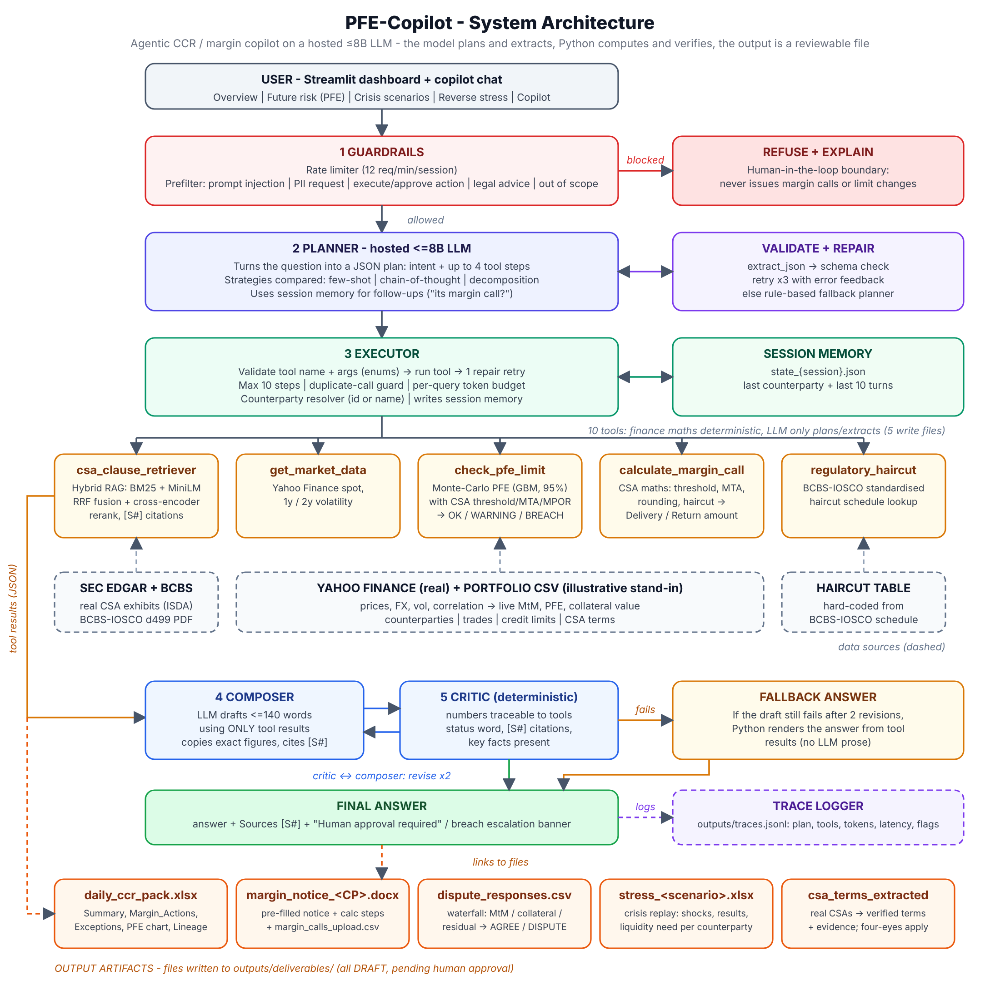

# PFE-Copilot: from CSA documents to a risk dashboard, daily pack and crisis stress tests

**Executive PG Programme in Generative AI and Agentic AI - IIT Kharagpur / upGrad - Capstone Track B (API-side, hosted <=8B LLM)**

> **Design principle:** the LLM *plans and extracts*; code *computes and verifies*; the product is a **reviewable file a desk can use**, not a chat answer. Nothing is sent, booked or changed without a named human approver.

---

## 1a. Risk dashboard: future risk and crisis risk (`streamlit run app.py`)

| Tab | What it shows | Method |
|---|---|---|
| **Overview** | KPI tiles, RAG table (PFE vs limit, margin action, top MtM driver), daily-pack download | Monte-Carlo PFE + deterministic CSA engine |
| **Future risk (PFE)** | Fan chart (50/75/90/95/99%), expected exposure, collateralised vs uncollateralised, limit line; sliders for **margin period of risk** and **volatility multiplier** | Correlated GBM from Yahoo Finance history; VM-only CSA collateral with MPOR lag |
| **Crisis scenarios** | Historical replays (**GFC 2008, COVID 2020, rates 2022, taper 2013**), hypothetical shocks (equity -20/-40%, USD spike, rates up) and a **custom shock builder**. Shows gap exposure after collateral, stressed margin calls (**liquidity need**), BREACH today vs after stress, Excel export | Realised Yahoo returns over the crisis window applied to trades **and posted collateral together** (wrong-way / gap risk); stressed PFE re-simulated from the shocked market with higher vol/correlation |
| **Reverse stress** | How far must markets move (down/up) before exposure after collateral breaches the limit | Uniform market-move scan with limit-crossing marker |
| **Copilot** | Chat that can produce all the files below and run stress tests ("What happens in a COVID-style crash?") | Planner-executor-critic agent |

### Where AI adds value in risk analysis (and where it deliberately does not)

| Use | How | Control |
|---|---|---|
| **AI-assisted scenarios** | Describe a crisis in words ("the Fed hikes 100bp, the dollar rallies, spreads widen"); the LLM proposes five bucket shocks (equity, gold, long rates, IG credit, USD). Available in the Crisis tab (editable sliders) and as the chat tool `run_custom_scenario` | JSON validated with repair-retry; percent-vs-decimal slips corrected; **every shock clamped to bounds** (e.g. equities -70% to +40%); adjustments reported; a human reviews the shocks; the stress engine, not the model, computes exposure |
| **Forward-looking volatility** | EWMA (RiskMetrics) volatility that mean-reverts to the 2y level (GARCH(1,1)-style term structure, half-life ~34 days) drives the Monte-Carlo | **Backtested** out of sample (next 21-day realised vol) against flat 2y vol; the notebook picks the model by the result and saves it to `outputs/vol_model.txt`. Statistical forecasting, not an LLM; full GARCH is not fitted |
| Not used: LLM-predicted exposures or breaches | An 8B model cannot forecast risk reliably and invented numbers would fail model-risk review | PFE and stress numbers always come from simulation / revaluation code |

Stress assumptions to state in the report: instantaneous shock before any new margin call (gap exposure), stressed PFE vol multiplier 1.5 and correlation blend 0.2 (configurable via `STRESS_VOL_MULT`, `STRESS_CORR_BLEND`), a "uniform move" reverse stress, linear products only; EWMA/mean-reversion is a GARCH-style shortcut, not a fitted GARCH; AI scenarios are proposals bounded by code. If a ticker has no history for a crisis window, the shock is set to 0 and a data note is shown - do not quote such a scenario.

### Why AI, where, and how it is governed
Most of the project is deliberately **not AI**: exposure, margin, stress, SA-CCR and volatility are deterministic code that can be validated. The language model is used where text is messy: reading CSA contracts, understanding free-form requests, turning a described crisis into bounded shocks, and phrasing answers - each behind a verification gate or critic and a human approval step. **Section 9a (ablation)** runs the evaluation with the model switched off versus on, so the report can show *where it adds value* (hard paraphrased queries) and *where rules are enough* (templated ones). Governance details - AI use register, controls, review cadence, kill switch (`PFE_KILL_SWITCH=1`) and rules-only fallback (`PFE_LLM_OFF=1`) - are in `GOVERNANCE_CARD.md`.

## 1. What it produces (usable outputs)

| # | Output | Format | Verification before a human sees it | Consumer |
|---|---|---|---|---|
| 1 | **CSA term sheet** extracted from real SEC EDGAR CSAs (threshold, MTA, rounding, independent amount, base currency, valuation agent, notification time, eligible collateral) | `.xlsx` (colour-coded status + Evidence sheet) and CDM-inspired `.json` | **Verification gate:** quote must exist verbatim in the source, contain the number, and state exactly one amount - else `REVIEW` / `NOT_FOUND`. `apply_terms()` needs a named approver, writes a backup + audit log | Collateral onboarding / legal ops |
| 2 | **Daily exposure & margin pack** | `.xlsx`: Summary (RAG), Margin_Actions, Exceptions (analyst notes), PFE chart, CSA terms used, Lineage | Exception notes pass a figure-grounding check; red banner if synthetic fallback data was used | CCR analysts / limit monitoring |
| 3 | **Margin call notice** | `.docx` pre-filled (calc steps, trades, approval block) + `margin_calls_upload.csv` | Amounts from deterministic CSA engine; status `DRAFT_PENDING_APPROVAL` | Collateral operations |
| 4 | **Stress test workbook** (`stress_<scenario>.xlsx`): shocks applied, per-counterparty stressed MtM / collateral / exposure / PFE / status, liquidity sheet | `.xlsx` | Shocks from realised returns or declared presets; status colour-coded; data-gap notes | Risk managers / treasury |
| 5 | **AI-assisted scenario workbook** (`stress_custom_*.xlsx`): proposed shocks, source (LLM or rules), clamping notes, per-counterparty results | `.xlsx` | Bounds + human review of shocks | Risk managers |
| 6 | **Dispute reconciliation** | waterfall (MtM difference -> collateral value -> rounding/MTA/terms), `AGREE / PARTIAL_AGREE / DISPUTE`, agreed vs disputed amount -> `dispute_responses.csv` | Deterministic attribution; undisputed amount computed per CSA mechanics | Dispute desk |
| 7 | Q&A with citations (PFE limit, margin, haircut, CSA/BCBS clause lookup, Yahoo Finance vol) | chat + `[S#]` sources | Critic: numbers/status/citations must trace to tool output | Anyone |

### Why these outputs (pattern seen in industry deployments)
- **JPMorgan COIN** extracted structured attributes from commercial loan agreements rather than chatting about them; **ISDA/DRS Ark 51** converts CSAs into CDM data for collateral systems such as **Vermeg COLLINE**, where data goes through four-/six-eyes validation.
- **Morgan Stanley Debrief** drafts notes, tasks and emails that are saved into Salesforce for the advisor to review - and Morgan Stanley evaluates each use case on test sets before release.
- Collateral vendors (e.g. OSTTRA triResolve) emphasise exception-based workflows and dispute management as the biggest inefficiency - hence outputs 3 and 4.
- Industry commentary attributes a large share of collateral disputes to incorrect or inconsistent CSA/agreement data - hence output 1 plus an audit trail.

## 2. Architecture



*(Vector: `docs/architecture.svg`.)* Flow: guardrails -> planner (LLM, validated JSON) -> executor over **10 tools** (5 analytic + 5 that write files; finance maths is deterministic) -> composer <-> critic -> answer + files + human-approval banner, fully traced.

## 3. Data (real wherever possible)

| Data | Source | Notes |
|---|---|---|
| ISDA CSAs / schedules | **SEC EDGAR** full-text search, exhibit filings | `N_CSA_DOCS` configurable; manual PDFs can be dropped into `data/csa/` |
| Margin & haircut regulation | **BCBS-IOSCO d499** | haircut table also encoded in `regulatory_haircut` (spot-check vs the PDF) |
| Prices, FX, vol, correlation | **Yahoo Finance** via `yfinance` | cached; runs are flagged `FALLBACK_SYNTHETIC` if Yahoo is unreachable |
| Counterparties, trades, limits | **Illustrative stand-in** | real books are confidential; no employer data or code is used. Terms can be replaced by approved extractions from real CSAs (output 1) |

### Data inventory, licensing and provenance

| Data | Used for | Format | Terms / provenance note |
|---|---|---|---|
| SEC EDGAR CSA / ISDA exhibits | RAG corpus, CSA term extraction | HTML / PDF -> text | Public filings; SEC fair-access rules (declared contact User-Agent, <=10 requests/s). They are *other companies'* agreements |
| BCBS-IOSCO d499 (margin framework); BCBS d279 (SA-CCR) | Haircut table, regulatory Q&A, SA-CCR parameters | PDF | Free to read; cite the source (check BIS reuse terms before redistributing) |
| Yahoo Finance via `yfinance` | Prices, FX, vol, correlation, crisis-window returns | daily CSV cache | Unofficial API; Yahoo's terms are personal/non-commercial use - fine for coursework, not for production (use a licensed feed there). Run is flagged if synthetic fallback was used |
| Counterparties, trades, limits | Illustrative portfolio | CSV | Synthetic stand-in; no employer data. Real books would arrive as FpML/CDM |
| LLM endpoint (Qwen3-8B) | Planning, extraction, scenario translation, phrasing | HTTPS, course quota | Prompts contain no personal data; responses cached locally, key never stored |

**Data provenance statement:** the notebook's last section runs `provenance_report()` and saves `outputs/data_provenance.csv`, labelling every dataset REAL / SYNTHETIC (by design) / HYPOTHETICAL / DERIVED / UNVERIFIED, and refuses to package a `FINAL_RUN` if prices fell back to synthetic. Synthetic prices are also switched off automatically whenever an LLM key is configured.

| FRED US Treasury CMT par yields | Discount/projection curve for the optional swap module | CSV via `fredgraph.csv` | Public; real. A Treasury curve is a stand-in for a SOFR swap curve (single-curve simplification) |
| ORE / FpML-style swap structures | Optional netting set CP-007 (3 vanilla swaps) | CSV (`swaps.csv`) | **Industry test structures, not real trades.** Structures are re-encoded by hand from ORE's published example style; the ORE/FpML XML files are *not* parsed |

### Optional module: industry-standard interest-rate swap test structures (Section 5a)
Kept deliberately small and self-protecting: vanilla fixed-vs-float swaps only, one netting set (CP-007), spot-starting at each run, one-factor Hull-White (`HW_A`, `HW_SIGMA` are **assumptions**, not calibrated to swaption vols), rate factor independent of the equity/FX factors, swaps stressed through a parallel yield shift mapped from the long-bond return. **Five automatic gates** (curve reprices its par yields; Hull-White martingale test; par swap = 0; ATM swap exposure symmetric; Monte-Carlo quantile equals the analytic mapping) must pass before swaps join the portfolio - otherwise the section skips itself and the project runs unchanged (`INCLUDE_IRS = False` disables it). Not done: parsing ORE/FpML XML files, comparing against ORE's own exposure output (a manual stretch: run an ORE example with the same swap and curve and compare EPE profiles), multi-curve/OIS discounting, swaption-based calibration.

Not included on purpose (documented as future work): cross-currency swaps and options, FpML/ISDA-CDM trade ingestion, ORE as an external benchmark, rating-trigger thresholds.

## 3b. Validation and controls

| Control | What it does |
|---|---|
| **Engine validation** (`validate_engine`, notebook 5g, dashboard button) | Monte-Carlo PFE vs closed-form lognormal quantile (long/short, 4 horizons) plus invariants (collateral never raises PFE, huge threshold switches collateral off, netting, 1-day MPOR) and CSA/haircut unit tests - 24 checks; the notebook stops if one fails |
| **SA-CCR cross-check** (daily-pack sheet, dashboard expander) | Simplified Basel SA-CCR EAD vs Monte-Carlo EAD (1.4 x effective EPE); a regulatory sanity check, constants to be verified against BCBS d279 |
| **Artifact manifest** (`outputs/artifact_manifest.csv`) | SHA-256, size, timestamp, volatility model for every generated file - tamper-evident audit trail |
| **Human answer review** (`outputs/answer_review.csv`) | Expert 1-5 rubric (correctness, usefulness, grounding, clarity) on a stratified sample, alongside automated accuracy |
| **Term-change audit** (`outputs/csa_terms_audit.csv`) | Who approved which extracted CSA term, with the evidence quote |

## 4. Track B requirement mapping

| Requirement | Where |
|---|---|
| Spec + frozen eval set before agent evaluation | Sections 2 and 6 - **100 queries (24 hard paraphrased)** (limit, margin, haircut, clause, market data, multi-turn, refusal, **deliverables**) |
| >=3 prompting strategies, small-model failure modes | Section 7 |
| RAG: chunking experiments, BM25+dense, reranker, citations, recall@k separate from answer quality | Section 4 incl. **4.3 blind, human-labelled Recall@K / MRR / nDCG** |
| Agent: >=3 tools, planner->executor->critic, memory, error handling | Library + Sections 8, 10 |
| Evaluation: accuracy, completion, tool calls, cost, latency, failure taxonomy | Section 9 |
| **Extraction quality** (new) | Section 5b: human review sheet -> VERIFIED-gate precision, coverage, LLM vs regex baseline |
| Model validation / benchmark | Section 5g: closed-form benchmark, invariants, simplified SA-CCR cross-check |
| Tracing + trace dashboard | `outputs/traces.jsonl` + Streamlit **Observability** tab (latency p50/p95, tool usage, flags, per-trace inspector); forward records to Langfuse/LangSmith if your rubric requires a specific tool |
| Ship: front-end (with file downloads), container, rate limit, cache | Section 11 |
| Responsible AI: injection, PII, refusal, HITL | Section 10 |
| "What did we do to compensate for a small model?" | Section 12 |

## 5. Quickstart (Google Colab via GitHub - no GPU needed)

[](https://colab.research.google.com/github/premchand0001-droid/PFE_Copliot/blob/main/PFE_Copilot_Capstone.ipynb)

1. Push this folder to a (private) GitHub repo and replace `premchand0001-droid/PFE_Copliot` in this README and in the notebook (`GITHUB_COLAB_GUIDE.md`, section A).
2. In Colab add the secrets `LLM_API_KEY` (and `GITHUB_TOKEN` for a private repo).
3. Open the notebook with the badge; run the **bootstrap cell** (clones the repo, asks you to upload your group's `.crt`), then the config cell (`USE_DRIVE = True`), the library cells, the smoke test and the **pre-flight** check.
4. Follow `docs/CAPSTONE_RUNBOOK.md` phase by phase. Manual steps (about 1 hour): label `outputs/retrieval_labeling.csv` (Section 4.3), `outputs/extraction_review.csv` (5b), `outputs/answer_review.csv` (9b). Set `FINAL_RUN = True` for the graded run; Section 13 builds and downloads `pfe_copilot_submission.zip`; Section 14 can push results back to GitHub.
5. Long steps from a cell: `!python cli.py preflight | download --docs 500 | index | portfolio --irs | validate | pack`.
6. Dashboard in Colab: tunnel instructions in the guide (section E), or a free Hugging Face Space.

Optional redesign check: `Trigger_Intelligence_Spike.ipynb` is a one-hour feasibility spike (three pass/fail gates) for a downgrade-trigger-intelligence version of the project; it does not modify anything else.

Local IDE alternative: `LOCAL_SETUP.md`. No LLM key? The notebook still runs in **dry-run mode** (rule-based planner, regex extractor, deterministic answers); report numbers must come from the live endpoint.

## 5b. Track B endpoint constraints and how the client handles them

| Constraint (learner guide) | Handling |
|---|---|
| Model `Qwen/Qwen3-8B`; Qwen3 emits `<think>` blocks | thinking disabled (`enable_thinking=false` + `/no_think`) and any `<think>` text stripped; JSON extraction tolerant of prose |
| Private CA certificate, HTTPS verification must stay on | `requests` with `verify=<your .crt>` (`CA_CERT_PATH`); clear error message if missing |
| 1 active request per key; 60 requests/min | global lock + throttle (<=50/min); 429/503 retried after 2/4/8/16 s |
| 8192 tokens total; `max_tokens` <= 1024 | caps clamped to 1024; prompts/passages truncated; per-query token budget |
| No embeddings endpoint | local `all-MiniLM-L6-v2` embeddings and local cross-encoder reranker |
| Tool-call support | planner emits schema-validated JSON plans (JSON mode with automatic fallback + repair loop) - constrained output and validation are the focus of the track; native function-calling can be added as an experiment |
| Cost control | every response cached on disk (`outputs/llm_cache.jsonl`, excluded from the zip) - re-runs and demos cost no calls |

Setup helpers: the certificate file name (`vm04-ca.crt` etc.) identifies your VM, so the notebook derives your base URL from `CA_CERT_PATH` even if you do not know your group number; **Section 1b runs a pre-flight check** (LLM `/models`, certificate, Yahoo Finance, SEC EDGAR, BIS) and prints what to fix; packaging aborts if an API-key-like string is found in any file, and a `.gitignore` excludes the cache, certificates and `.env`.

Budget for the first live run: ~600 LLM calls (about 1-2 hours at endpoint latency) plus about 1 hour of manual labelling (retrieval sheet, extraction sheet).

## 6. Results (fill from your live run)

| Metric | Value |
|---|---|
| End-to-end accuracy strict / lenient (100 queries (24 hard paraphrased)) / task completion | _ / _ / _ |
| Avg tool calls, latency p50/p95, tokens, cost per query | _ |
| Retrieval: regex recall@5 vs **human** strict recall@1/3/5, MRR, nDCG@5 per mode | _ |
| Best prompting strategy (route accuracy, JSON first-try rate) | _ |
| **Ablation:** rules-only vs with-LLM accuracy per category, especially hard_paraphrase (Section 9a) | _ |
| **CSA extraction:** coverage; VERIFIED share; **VERIFIED precision**; REVIEW precision; LLM vs regex agreement | _ |
| Failure taxonomy counts | _ |
| Deliverable + stress queries passing (file created + figures correct) | _ |
| AI scenario translation accuracy (8 tests) and chosen volatility model (backtest wins out of 8 tickers, mean RMSE change) | _ |
| PFE change flat-hist vs EWMA volatility per counterparty | _ |
| Stress scenarios run on real history: liquidity need, BREACH before -> after (screenshot the dashboard) | _ |

## 7. Responsible AI and controls

- **Human-in-the-loop:** drafts only (`DRAFT_PENDING_APPROVAL`); no sending, booking or approving; term changes require `approved_by`, produce a backup and an audit CSV.
- **Verification gate on extraction:** LLM output reaches the engine only if quote-in-source, number-in-quote and single-amount checks pass **and** a human approves.
- **Grounding critic** on every prose answer; deterministic fallback when it fails.
- **Prompt injection / PII:** retrieved text sanitised and redacted; document-poisoning test in Section 10.
- **Transparency:** Lineage sheet, data-source flags, synthetic-data banner.

## 8. Limitations (state in the report)

`VERIFIED` means *literally supported by the quote*, not *legally correct* - party mapping (Party A vs B) and elections still need a human. JSON output is CDM-**inspired**, not validated against the FINOS CDM schema. Linear forwards only; GBM with historical vol; VM-only CSA with cash VM and uniform MPOR; illustrative portfolio and limits; EDGAR CSAs are other companies' agreements; dispute tolerance (`max(rounding, 1% of call)`) is an assumption; haircut table to be spot-checked; recall labels pooled from the same four systems.

## 8b. Future work

1. **User-selectable risk models in the copilot (priority).** Today the dashboard lets you switch the volatility model (EWMA or flat) and shows a simplified SA-CCR cross-check, but the copilot always calculates PFE with one fixed Monte-Carlo method. Planned: a model registry behind a single tool such as `calculate_pfe(counterparty, model=...)`, so a user can say which method to use, for example:
   - Monte-Carlo with flat historical volatility;
   - Monte-Carlo with EWMA volatility;
   - stressed volatility and correlation;
   - Hull-White for swaps;
   - regulatory SA-CCR.
2. **Multi-model comparison and summary.** The copilot should run several of these calculations for the same counterparty on request ("compare all PFE models for Meridian") and summarise them side by side: the figures, which model is highest, the main assumptions that explain the differences, and any limit status that changes depending on the model. Numbers would still come from the deterministic tools, with the model-written summary checked against them by the existing critic and verification gates. The result would be an Excel/Word comparison file marked as a draft pending approval.
3. **Downgrade-trigger intelligence:** extend contract and filing extraction to rating-dependent thresholds and disclosed collateral calls (see `Trigger_Intelligence_Spike.ipynb`).
4. **Richer products and calibration:** swaptions-calibrated Hull-White, multi-curve (SOFR/OIS) discounting, cross-currency swaps and options.
5. **Standard formats and benchmarks:** FpML / ISDA-CDM trade and CSA ingestion, and a comparison of exposure profiles with ORE's published example results.
6. **Wrong-way risk, rating-trigger thresholds and non-cash collateral** in the CSA model.

## 9. Repository layout

```
pfe_copilot_submission/
├── PFE_Copilot_Capstone.ipynb    # Main executable notebook
├── pfe_copilot.py                # Core library (generated by the notebook)
├── app.py                        # Streamlit dashboard + copilot chat
├── cli.py                        # terminal commands: preflight, download, index, portfolio, validate, pack, dashboard
├── .env.example                  # copy to .env for your key and certificate path
├── Dockerfile                    # Container configuration
├── requirements.txt              # Project dependencies
├── README.md                     # Overview and setup
├── GOVERNANCE_CARD.md            # AI use register, controls, review cadence, kill switch
├── docs/
│   ├── architecture.png
│   ├── architecture.svg
│   └── REPORT_AND_DEMO_OUTLINE.md   # 12-page report map + 10-minute demo run of show
├── data/
│   ├── csa/                      # Saved SEC EDGAR ISDA/CSA documents (.txt / .json)
│   ├── reg/                      # BCBS-IOSCO regulation (d499 .pdf / .txt)
│   ├── market/                   # Cached Yahoo Finance CSVs
│   └── portfolio/                # counterparties.csv & trades.csv (+ .bak.csv after apply)
└── outputs/
    ├── eval_set.json             # 100-query evaluation set
    ├── eval_results.csv          # Benchmark outputs
    ├── retrieval_labeling.csv    # Blind labelling sheet (human 0/1/2)
    ├── retrieval_eval_human.csv  # Strict Recall@K / MRR / nDCG
    ├── extraction_review.csv     # Human review of CSA extraction
    ├── csa_terms_audit.csv       # Audit trail of applied terms (if any)
    ├── vol_model.txt             # volatility model chosen by the backtest
    ├── artifact_manifest.csv     # SHA-256 audit trail of generated files
    ├── answer_review.csv         # human 1-5 rubric ratings
    ├── traces.jsonl              # Execution traces
    └── deliverables/             # daily_ccr_pack_*.xlsx, stress_<scenario>_*.xlsx, margin_notice_*.docx, margin_calls_upload.csv,
                                  # dispute_responses.csv, csa_terms_extracted.xlsx / .json
```
